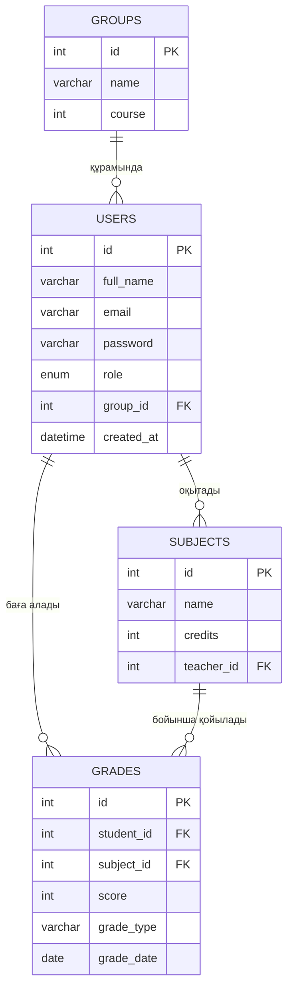

# Студенттердің үлгерімін есепке алу жүйесі

## Жоба сипаттамасы
Жоба оқу орнындағы студенттердің үлгерімін онлайн есепке алуға арналған веб-қосымша. Оқытушы пәндер бойынша студенттерге баға қояды, студент өз бағаларын көреді, әкімші пайдаланушыларды, топтар мен пәндерді басқарады.

**Мақсаты:** қағаз журналды алмастырып, бағаларды енгізу, сақтау және қарау процесін жеңілдету.

## Технологиялар
- PHP (PDO)
- MySQL
- HTML, CSS, JavaScript
- Git / GitHub

## Пайдаланушы рөлдері
| Рөл | Мүмкіндіктері |
| --- | --- |
| Әкімші (admin) | Пайдаланушыларды, топтарды және пәндерді басқару |
| Оқытушы (teacher) | Өз пәні бойынша студенттерге баға қою, өңдеу, жою |
| Студент (student) | Өз бағалары мен орташа баллын қарау |

## Негізгі мүмкіндіктер
- Тіркелу және жүйеге кіру (парольді хэштеу, сессиялар)
- Студенттерді, топтарды, пәндерді қосу, көру, өңдеу және жою (CRUD)
- Студенттерге баға қою және өңдеу
- Студентті іздеу (аты-жөні бойынша)
- Бағаларды пән, топ және дата бойынша сүзу
- Орташа балл есептеу
- Деректерді тексеру (валидация) және қауіпсіздік шаралары (prepared statements, `htmlspecialchars()`)

## Беттер тізімі
| № | Файл | Сипаттамасы |
| --- | --- | --- |
| 1 | `index.php` | Басты бет: жоба туралы қысқаша ақпарат |
| 2 | `register.php` | Тіркелу формасы |
| 3 | `login.php` | Жүйеге кіру формасы |
| 4 | `logout.php` | Жүйеден шығу |
| 5 | `students.php` | Студенттер тізімі, іздеу және сүзу |
| 6 | `student_form.php` | Студентті қосу және өңдеу формасы |
| 7 | `subjects.php` | Пәндер тізімі |
| 8 | `grades.php` | Бағалар тізімі, сүзу және сұрыптау |
| 9 | `grade_form.php` | Баға қою және өңдеу формасы |
| 10 | `profile.php` | Студенттің жеке беті: бағалары және орташа балл |

## Дерекқор құрылымы (ER-диаграмма)

### Кестелер сипаттамасы
- **groups**: студент топтары (мысалы, 334 АЖ).
- **users**: барлық пайдаланушылар (әкімші, оқытушы, студент). `role` өрісі рөлді көрсетеді, `group_id` тек студенттерге толтырылады.
- **subjects**: пәндер. `teacher_id` пәнді жүргізетін оқытушыға сілтейді.
- **grades**: бағалар. `student_id` студентке, `subject_id` пәнге сілтейді. `grade_type` бағаның түрі (ағымдағы, аралық, емтихан).

**Байланыстар:** бір топта көп студент болады (1:N), бір оқытушы көп пән жүргізеді (1:N), бір студент көп баға алады (1:N), бір пән бойынша көп баға қойылады (1:N).

## Жоспар
- [x] 8-апта: жоспарлау, беттер тізімі, ER-диаграмма, репозиторий
- [ ] 9-апта: интерфейс (HTML, CSS, JS)
- [ ] 10-апта: PHP негіздері, include, формалар
- [ ] 11-апта: MySQL, тіркелу және кіру
- [ ] 12-апта: CRUD
- [ ] 13-апта: іздеу, сүзу, пагинация
- [ ] 14-апта: қосымша функциялар және қауіпсіздік
- [ ] 15-апта: тестілеу, хостинг, қорғау

## Автор
Нияз Асылай, 334 АЖ тобы
